# Flow.io Home Assistant Cards

Cartes de supervision et de pilotage pour les entités MQTT du firmware Flow.io-Waveshare. La version 0.3.2 a été construite ; la version 0.3.3 est en préparation. Le brouillon de release et la publication restent des étapes distinctes.

| Carte Piscine — clair | Carte Piscine — sombre |
|---|---|
|  |  |

| Historiques — clair | Historiques — sombre |
|---|---|
|  |  |

## Cartes

- `custom:flowio-header-card` : bandeau compact « état du bassin » avec le statut, une phrase de contexte et les jauges Eau · ORP · Air.
- `custom:flowio-filtration-card` : plage de filtration calculée (frise, début, fin, durée prévue).
- `custom:flowio-treatment-card` : informations du traitement actif, adaptées au type configuré (chlore/brome, électrolyse, oxygène actif, désactivé).
- `custom:flowio-equipment-card` : grille de tuiles pour les équipements sélectionnés (bascule par l’icône).
- `custom:flowio-modes-card` : grille de tuiles pour les modes manuel, automatique et hivernage.
- `custom:flowio-probes-card` : grille de sondes en barres ou jauges, nom/couleur/échelle configurables.
- `custom:flowio-probe-card` : sonde unique en barre ou jauge, nom/couleur/échelle configurables.
- `custom:flowio-alarms-card` : synthèse des alarmes surveillées et liste des alarmes actives.
- `custom:flowio-status-card` : informations système du contrôleur (IP, mémoire, temps de fonctionnement, tension, courant).
- `custom:flowio-override-card` : forçage d’un équipement en marche/arrêt pendant une durée choisie.
- `custom:flowio-graph-card` : un seul graphique ApexCharts (courbe ou barres) pour les entités choisies, avec couleur par entité.
- `custom:flowio-pool-card` : jauges pH/ORP/pression, températures, équipements, modes, alarmes, cuves et frise de filtration.
- `custom:flowio-history-card` : courbes ApexCharts alimentées par l'historique Home Assistant/Recorder.
- `custom:flowio-state-history-card` : frise des états booléens (interrupteurs et capteurs binaires) sur les 24 h du jour, avec position de l'heure courante.
- `custom:flowio-actuator-card` : tableau des actionneurs (nom, durées jour/semaine/mois/total) avec remise à zéro par ligne et globale.
- `custom:flowio-alarm-detail-card` : tableau des alarmes (déclenchement, condition, latch) avec acquittement par ligne et global.

Les cartes reprennent le thème Home Assistant et les motifs visuels Flow.io déjà établis. Elles privilégient les composants natifs de l’instance, notamment `ha-switch`, `ha-button`, `ha-icon` et la carte native de titre ; aucun substitut de ces contrôles n’est inclus dans le bundle de production.

## Installation

Après publication d'une release vérifiée, ajouter `ben33880/flowio-home-assistant-cards` aux dépôts personnalisés HACS, catégorie Dashboard. Le dépôt n'est pas ajouté automatiquement au catalogue HACS par défaut.

Ressource attendue : `/hacsfiles/flowio-home-assistant-cards/flowio-home-assistant-cards.js`, type module JavaScript. Ne pas charger simultanément une ancienne copie manuelle. Voir [installation HACS et manuelle](docs/HACS.md).

## Synthèse

```yaml
type: custom:flowio-pool-card
title: Supervision
entity_prefix: fio
grid_options:
  columns: full
display:
  measurements: [ph, orp, pressure, water_temperature, air_temperature]
  setpoints: [ph_setpoint, orp_setpoint]
  equipment: [filtration, ph_pump, disinfection_pump, lighting]
  modes: [filtration_auto, winter, ph_auto, disinfection_auto, heater_auto, disinfection_type, swg_control, ph_dose_plus, o2_temp_comp]
  tanks: [ph_tank_percent, disinfection_tank_percent]
  timing: [filtration_schedule, filtration_runtime, ph_runtime, disinfection_runtime]
  operations: [refill_ph, refill_disinfection, timed_override]
  values_telemetry: true
  calculated_values: [v00, v01]
  device_metrics: [water_in, water_out, current]
  information: [treatment_type, alarm_active, alarm_count, diagnostics, network, system]
tank_slots:
  ph: 1
  disinfection: 2
runtime_slots:
  filtration: 0
  ph: 1
  disinfection: 2
```

Toutes les options disponibles sont cochées par défaut dans les paramètres des deux cartes ; retirer celles qui ne sont pas utiles. La mesure dans « Qualité de l’eau » conserve le libellé ORP. Le traitement actif est déduit de l’entité firmware « Type de désinfection » ; le choix « Commande · type de désinfection » permet de le modifier. Le switch « Pompe désinfectant » pilote l’électrolyseur en mode électrolyse, ou la pompe désinfectant pour le chlore/brome et l’oxygène actif. En mode inconnu ou désactivé, les commandes dépendantes du traitement sont indisponibles. Le switch autonome de l’électrolyseur n’est plus affiché. Une liste vide masque le groupe. Les modes sont filtrés selon les équipements cochés et le mode firmware actif, sans effacer la sélection `display.modes`. « Valeurs et télémétrie » est contrôlable avec `display.values_telemetry`, occupe toute la largeur, s’aligne à gauche avec « Qualité de l’eau » et apparaît après les horaires.

Dans une vue Sections, `grid_options: { columns: full }` fait occuper à la carte toute la largeur de sa section par défaut lors de son ajout.

Le préfixe vaut `fio` par défaut : `piscine` construit `sensor.piscine_io_ph`. Un préfixe vide est accepté. Les noms métier du firmware sont conservés ; aucun choix automatique d'une entité suffixée `_2`.

Les anciens champs `entities`, `features`, `show_tanks`, `treatment` et `measurements` au premier niveau de la synthèse sont rejetés. Recréer les anciennes configurations avec `display`. Pour les historiques, `measurements` reste au premier niveau.

Pour compatibilité, l’ancien champ `display.treatment` n’empêche pas le chargement d’une carte, mais n’a plus d’effet ; le mode actif vient de `select.<préfixe>_pl_modes_dis`.

## Entête

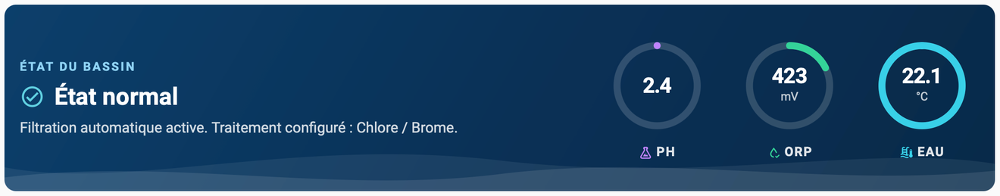

```yaml
type: custom:flowio-header-card
title: État du bassin
entity_prefix: fio
design: standard
measurements: [water_temperature, orp, air_temperature]
status: true
grid_options:
  columns: full
```

Le statut vient des alarmes firmware (`sensor.<préfixe>_alm_active_count` et `binary_sensor.<préfixe>_alm_any_active`) : « État normal » ou « Alarme en cours ». La phrase de contexte suit le mode de filtration (`switch.<préfixe>_pl_modes_auto`) et le type de traitement (`select.<préfixe>_pl_modes_dis`). Les jauges utilisent les bornes `min`/`max` des entités et le thème Home Assistant ; sans ces bornes, l’anneau reste vide. `status: false` masque le bandeau de statut. `design` vaut `standard` (thème Home Assistant) ou `flowio` (fond dégradé bleu avec vague en bas et jauges cyan/vert/orange) ; sur mobile, les jauges sont centrées horizontalement. Dans l’éditeur, la liste « Ordre d’affichage » (placée avant la liste des jauges) permet de classer les jauges affichées. Cette carte est autonome : elle ne modifie pas la carte piscine.

## Filtration

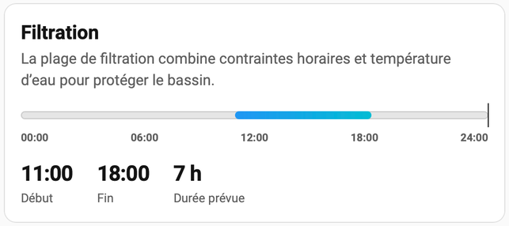

```yaml
type: custom:flowio-filtration-card
title: Filtration
entity_prefix: fio
```

La carte affiche la plage de filtration calculée par Flow.io depuis `sensor.<préfixe>_pl_flt_start` et `sensor.<préfixe>_pl_flt_stop` : frise sur 24 h, repère de l’heure courante, début, fin et durée prévue. C’est une fenêtre prévue, distincte des compteurs journaliers. `title` et `description` sont personnalisables.

## Traitement

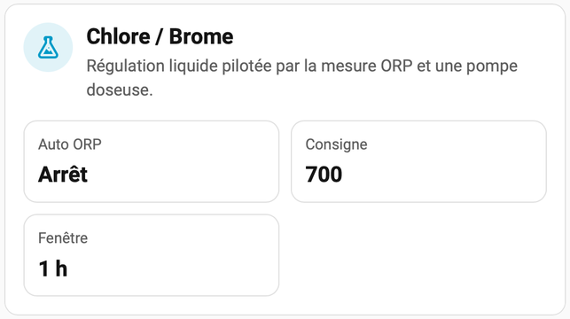

```yaml
type: custom:flowio-treatment-card
entity_prefix: fio
```

La carte lit le type de traitement depuis `select.<préfixe>_pl_modes_dis` et affiche uniquement les informations du traitement actif ; elle ne permet pas de le modifier. Chlore/Brome : `switch.<préfixe>_pl_dis_auto`, `number.<préfixe>_pl_dis_setpoint`, `number.<préfixe>_pl_dis_window`. Électrolyse : `select.<préfixe>_pl_swg_ctrl`, `number.<préfixe>_pl_swg_dly_elec`, `number.<préfixe>_pl_swg_min_temp`. Oxygène actif : `number.<préfixe>_pl_o2_vol`, `number.<préfixe>_pl_o2_dose`, `number.<préfixe>_pl_o2_split`, `sensor.<préfixe>_pl_o2_pending`. Une entité absente est signalée explicitement, jamais remplacée par zéro.

## Équipements

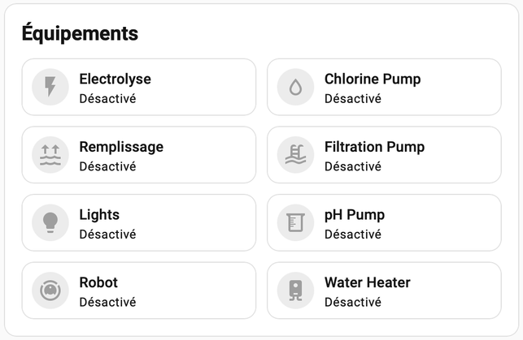

```yaml
type: custom:flowio-equipment-card
title: Équipements
entity_prefix: fio
columns: 2
entities: [switch.fio_io_flt_pmp, switch.fio_io_ph_pmp, switch.fio_io_chl_pmp]
```

Carte encadrée contenant une grille de tuiles standard Home Assistant. Le nom, le nombre de colonnes (1–6), le texte à retirer devant les noms (ex. « Flow.io Waveshare », vide = détection automatique) et la liste des entités se règlent dans l’éditeur ; la liste « Ordre d’affichage » qui précède la liste de choix permet de classer les entités dans l’ordre d’apparition par glisser-déposer (poignée à trois lignes). Cliquer sur l’icône bascule l’entité ; cliquer ailleurs ouvre l’entité. Les couleurs suivent l’état (tuile standard). Les démarrages sensibles et les sécurités restent gérés par Flow.io.

## Modes

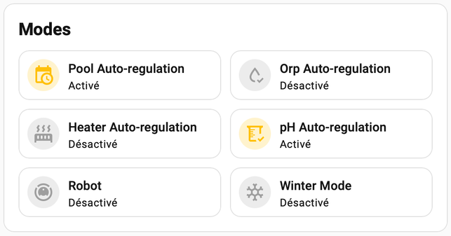

```yaml
type: custom:flowio-modes-card
title: Modes
entity_prefix: fio
columns: 2
entities: [switch.fio_pl_modes_auto, switch.fio_pl_modes_winter, switch.fio_pl_ph_auto_mode]
```

Même modèle que la carte Équipements : grille de tuiles standard, nom, colonnes, texte à retirer devant les noms et entités configurables, avec la liste « Ordre d’affichage » pour classer les modes. Cliquer sur l’icône bascule le mode ; cliquer ailleurs ouvre l’entité. Les modifications peuvent changer le pilotage automatique ; les sécurités restent dans Flow.io.

## Sondes

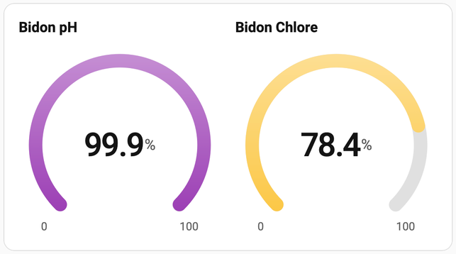

```yaml
type: custom:flowio-probes-card
title: Sondes
entity_prefix: fio
columns: 2
entities: [sensor.fio_io_wat_tmp, sensor.fio_io_orp]
name_prefix: ''
items:
  sensor.fio_io_orp:
    name: Redox
    color: '#8e24aa'
    min: 350
    max: 900
    mode: gauge
```

`columns` règle le nombre de colonnes de la grille (1–6). `entities` liste les sondes affichées (l’éditeur propose les capteurs du préfixe, avec le préfixe d’équipement retiré). Le nom affiché retire le préfixe commun (par exemple « Flow.io Waveshare »), détecté automatiquement ou forcé via `name_prefix`. Chaque sonde peut être personnalisée via `items[<entité>]` : `name` (nom convivial), `color` (nom de modèle Flow.io ou code CSS), `min`/`max` (échelle) et `mode` (`line` = barre, ou `gauge` = jauge). Sans personnalisation, la couleur suit le modèle Flow.io, l’échelle reprend les bornes `min`/`max` de l’entité (barre ou jauge laissée vide si absentes), et le mode est `line`. La liste « Ordre d’affichage » (placée avant la liste de choix) permet de classer les sondes dans l’ordre d’apparition. Les anciens champs `colors` et `scales` restent acceptés et migrés. Une entité absente est signalée explicitement.

## Sonde unique

```yaml
type: custom:flowio-probe-card
entity_prefix: fio
entity: sensor.fio_io_ph
name_prefix: ''
item:
  name: pH
  color: '#8e24aa'
  min: 6
  max: 8.4
  mode: gauge
```

Même modèle que la carte Sondes, pour une seule entité. Le titre de la carte est directement le nom (modifiable) de l’entité : le préfixe commun est retiré automatiquement (ou forcé via `name_prefix`), et le champ « Nom convivial » (`item.name`) le remplace. Vider ce champ (`item.name: ''`) masque le titre et l’espace qu’il occupe. L’éditeur propose la liste des capteurs du préfixe dans une liste déroulante (sélection unique), puis permet de régler le nom, la couleur, l’échelle `min`/`max` et le mode (`line` = barre, ou `gauge` = jauge). Sans personnalisation, la couleur suit le modèle Flow.io et l’échelle reprend les bornes `min`/`max` de l’entité (barre ou jauge laissée vide si absentes). Une entité absente est signalée explicitement.

## Alarmes

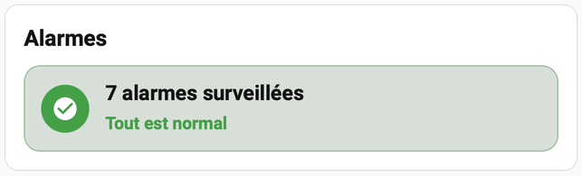

```yaml
type: custom:flowio-alarms-card
title: Alarmes
entity_prefix: fio
```

Synthèse des alarmes surveillées (`binary_sensor.<préfixe>_alm_*_active`) : nombre total et état, puis liste des alarmes actives. `name_prefix` retire un texte devant les noms (vide = détection automatique). Aucune alarme n’est acquittée par cette carte.

## État système

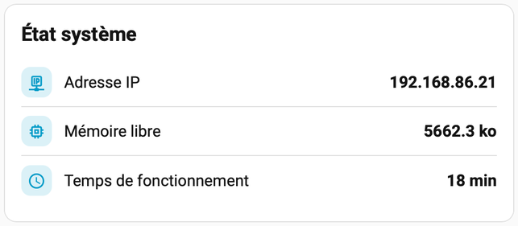

```yaml
type: custom:flowio-status-card
title: État système
entity_prefix: fio
items: [wifi_ip, sys_hp_free, sys_upt_mn]
```

Informations réseau et système du contrôleur : adresse IP/MAC, signal Wi-Fi, temps de fonctionnement, mémoire libre/minimale/fragmentée, tension et courant. Le temps de fonctionnement est converti en jours, heures ou minutes.

## Forçage

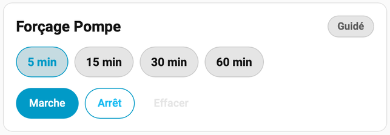

```yaml
type: custom:flowio-override-card
title: Forçage temporaire
entity_prefix: fio
device: Filtration
durations: [5, 15, 30, 60]
```

Force l’équipement choisi en marche ou à l’arrêt pendant une durée sélectionnée (5, 15, 30, 60 min), puis termine le forçage. L’équipement se choisit dans la liste publiée par Flow.io (`select.<préfixe>_pdm_ovr_target`) ; les durées sont modifiables. Les commandes demandent confirmation et Flow.io reste responsable des sécurités.

## Graphique

| Courbe (Temperature) | Courbe (ORP) |
|---|---|
| 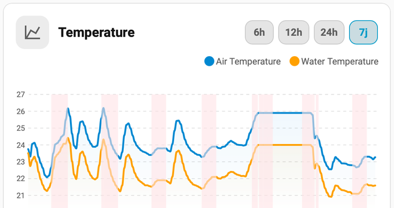 | 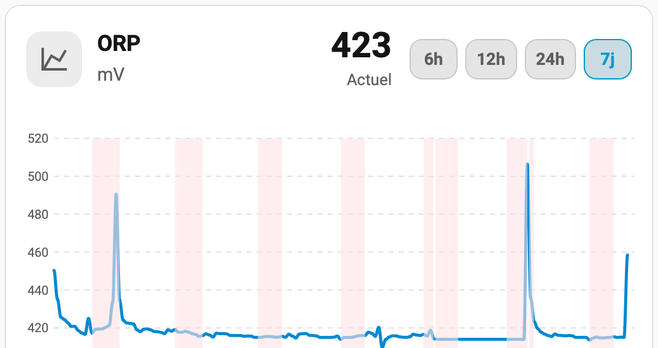 |

```yaml
type: custom:flowio-graph-card
title: Température de l’eau
entity_prefix: fio
entities: [sensor.fio_io_wat_tmp]
hours_to_show: 12
chart_type: line
colors:
  sensor.fio_io_wat_tmp: '#0288d1'
shades:
  switch.fio_io_flt_pmp: ''
```

Un seul graphique ApexCharts, en courbe (`line`) ou en barres (`bar`). `entities` liste les séries (l’éditeur propose toutes les entités du préfixe) ; `name_prefix` retire un texte devant les noms (vide = détection automatique) ; chaque série peut recevoir une couleur via `colors` (choix par pastilles dans l’éditeur, ou code CSS). La couleur n’est portée que par le graphique : en-tête et pied restent au thème. Des boutons de période (6 h, 12 h, 24 h, 7 j) ajustent l’intervalle ; `hours_to_show` fixe la période par défaut (12 h, 1–168). `shades` liste des entités on/off (pdN) : leurs périodes allumées sont ombrées dans le graphique, avec une couleur pastel réglable dans l’éditeur (vide = palette par défaut). Avec une seule entité, l’en-tête affiche son nom, son unité et la valeur actuelle, et le pied le minimum, la moyenne des échantillons et le maximum ; `show_stats: false` masque ce bandeau Min · Moy · Max. Les données proviennent du Recorder ; aucune valeur indisponible n’est remplacée par zéro. Les valeurs sont consolidées selon la période (moyenne par intervalle) via les statistiques du Recorder : 5 min sur 6 h, 10 min sur 12 h, 15 min sur 24 h et 1 h sur 7 j, pour alléger le chargement ; les entités sans statistiques retombent sur l’historique brut, regroupé de la même façon.

## Historiques

```yaml
type: custom:flowio-history-card
entity_prefix: fio
hours_to_show: 24
measurements: [water_temperature, ph, orp, pressure]
calculated_values: [v00, v01]
```

Le Recorder doit fournir les historiques des entités choisies. Les valeurs calculées peuvent aussi être affichées dans la carte piscine avec `display.calculated_values`. La carte ne remplace pas la configuration du Recorder.

## Historique des états

```yaml
type: custom:flowio-state-history-card
title: Historique
entity_prefix: fio
name_prefix: Flow.io Waveshare
entities:
  - switch.fio_io_flt_pmp
  - switch.fio_io_lights
  - binary_sensor.fio_alm_any_active
```

Une frise par entité couvre les 24 heures de la journée en cours : la piste reste grise quand l'état est inactif et prend la couleur d'activation quand il est actif (`on` ou `true`), l'icône s'allume avec l'état et un badge en haut de la frise marque l'heure courante, avec la durée d'activation du jour à droite. Les entités se choisissent dans la liste des interrupteurs et capteurs binaires du préfixe (`switch.*` et `binary_sensor.*`) ; `name_prefix` retire un texte devant les noms (vide = détection automatique) et l'ordre d'affichage se règle par glisser-déposer dans l'éditeur. Chaque entité peut être personnalisée via `items[<entité>]` : `name` (nom affiché, remplace le préfixe retiré) et `color` (couleur d'activation, choisie par pastilles dans l'éditeur ou code CSS ; vide = couleur d'activation par défaut). Les données viennent du Recorder ; une entité absente n'est pas transformée en zéro.

## Équipements du bassin

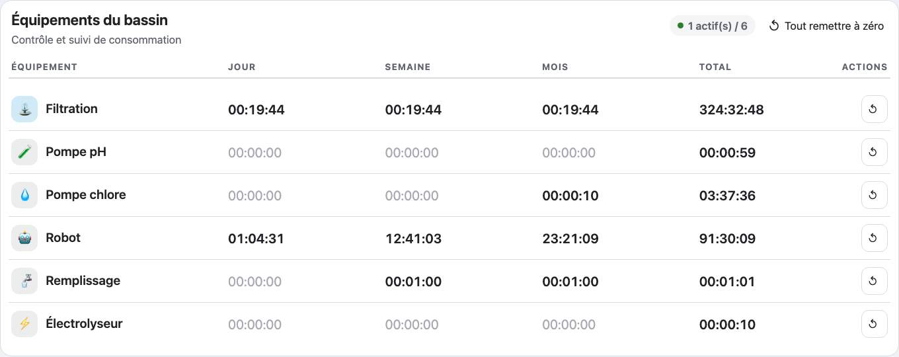

```yaml
type: custom:flowio-actuator-card
title: Équipements du bassin
subtitle: Contrôle et suivi de consommation
entity_prefix: fio
entities:
  - switch.fio_io_flt_pmp
  - switch.fio_io_ph_pmp
  - switch.fio_io_chl_pmp
  - switch.fio_io_robot
  - switch.fio_io_fill_pmp
  - switch.fio_io_chl_gen
resets:
  switch.fio_io_robot: button.fio_pd_reset_upt_robot
```

Tableau des actionneurs sans interrupteur : nom, icône et durées de fonctionnement **jour / semaine / mois / total**, lues dans les attributs de chaque entité de commutation (`uptime_day_s`, `uptime_week_s`, `uptime_month_s`, `uptime_total_s` — en secondes — par défaut, modifiables via `runtime_keys`). L'icône prend la couleur d'activation quand l'actionneur est en marche (`on`), sinon elle reste neutre. Les durées nulles sont grisées. Un bouton ↺ en fin de ligne remet à zéro les compteurs de l'actionneur (`button.<préfixe>_pd_reset_upt_*`), et « Tout remettre à zéro » cible `button.<préfixe>_pd_reset_upt_all`. Le mapping rôle → remise à zéro couvre filtration, pompe pH, désinfection, électrolyseur et remplissage ; les autres actionneurs se règlent via `resets[<entité>]`. Les commandes demandent confirmation. L'éditeur permet de choisir le titre, le sous-titre, le préfixe, le texte à retirer devant les noms et la liste des actionneurs, et l'ordre se règle par glisser-déposer.

## Gestion des alarmes

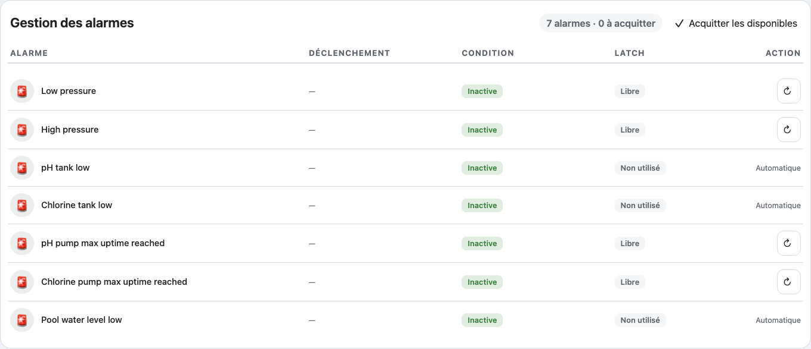

```yaml
type: custom:flowio-alarm-detail-card
title: Gestion des alarmes
entity_prefix: fio
alarms:
  - binary_sensor.fio_alm_1_active
  - binary_sensor.fio_alm_2_active
  - binary_sensor.fio_alm_3_active
```

Tableau des alarmes : nom, **condition** (`Active` en rouge ; `Inactive` en orange si l'alarme est active/latchée ; `Inactive` en vert sinon, d'après `attributes.condition` et l'état du `binary_sensor`) et **action**. L'icône de la ligne passe en rouge quand l'alarme est active. Les alarmes latchées (`latch_enabled`) proposent un bouton d'acquittement (icône ↻, `button.<préfixe>_alm_<id>_reset`, activé si `resettable`) ; les autres laissent la colonne vide. Un en-tête récapitule « N alarmes · M à acquitter » et un bouton **« Acquitter les disponibles »** traite toutes les alarmes acquittables. Les commandes demandent confirmation. Les alarmes se choisissent dans la liste `binary_sensor.<préfixe>_alm_*_active` (éditeur), avec `name_prefix` pour retirer un texte devant les noms et classement par glisser-déposer.

## Commandes et limites

- Consulter une valeur ouvre les informations de l'entité ; changer un contrôle peut commander la piscine.
- Si `network` ou `system` est sélectionné dans `display.information`, une icône discrète « Système » apparaît juste après le titre « Supervision » ; les badges « Traitement » et « Alertes » sont alignés à droite. Le bouton est utilisable au toucher sur mobile. Le dialogue présente les informations réseau et système ; la ligne « Signal Wi-Fi » apparaît uniquement si sa valeur est disponible. Les icônes proviennent des entités Home Assistant ; tension (V) et courant (A) sont lus depuis `sensor.<préfixe>_io_voltage` et `sensor.<préfixe>_io_current`, indépendamment de `device_slot`.
- Les actions de remplissage sélectionnées apparaissent sous forme d’icônes avec infobulle à côté des jauges des cuves pH et désinfectant. Les remises à zéro sélectionnées pour filtration, pH et désinfection apparaissent sous leur durée correspondante dans « Horaires & durées ». Une durée est affichée automatiquement si son action de remise à zéro est sélectionnée. Les actions gardent leur confirmation et sont omises du panneau général lorsqu’elles sont placées auprès de leur valeur.
- Les autres boutons s’affichent uniquement lorsqu’ils sont sélectionnés. Le forçage temporaire s’ouvre dans une boîte de dialogue Home Assistant avec le formulaire et les commandes disponibles du firmware ; sa sélection est globale et partagée entre utilisateurs.
- La pression est affichée et historisée sans conversion, telle que fournie par l’entité firmware. Son échelle visuelle par défaut est numérique (0,15–1,8), sans hypothèse d’unité ni zone de qualité.
- La télémétrie d’équipement et les valeurs calculées sont en lecture seule. Les métriques équipement utilisent `device_slot` (0–15) ; vérifier l’affectation dans Flow.io. Les informations réseau et le diagnostic système s’ajoutent via `display.information`.
- Les démarrages sensibles et certains changements de stratégie demandent confirmation.
- Un appel de service accepté ne confirme pas physiquement la marche d'un appareil. Les modes affichés suivent le retour d'état Home Assistant.
- Désactiver un automatisme ne signifie pas nécessairement arrêter sa sortie.
- Les protections, interlocks et règles de dosage restent dans Flow.io. La carte ne garantit pas la qualité de l'eau.
- La frise représente une plage prévue, distincte des compteurs journaliers.
- Les cuves affichent des estimations firmware. Vérifier les slots et la diffusion HA des valeurs ; une absence n'est pas transformée en zéro.
- Le dialogue d'alarme n'acquitte que via les boutons individuels disponibles exposés par le firmware.
- Les composants internes de Home Assistant peuvent évoluer : valider le rendu sur la version réellement utilisée. Aucune version minimale HA n'est annoncée sans vérification.

## Développement et release

Node.js 24 et ubuntu-24.04 sont conservés.

```sh
nvm install
nvm use
npm ci
npm test
npm run build
npx playwright install chromium
npm run test:e2e
```

Le lockfile est versionné et utilisé par la CI et les releases avec `npm ci`. Pour toute modification volontaire des dépendances, mettre à jour le lockfile via le workflow manuel de préparation, puis revoir et fusionner sa PR. Les tests unitaires incluent `tests/` et `src/`.

La démo utilise des données fictives et un substitut de `ha-switch` limité à `demo/`. Elle ne valide ni le véritable frontend HA ni le matériel. Les tests ne commandent aucun équipement réel.

Voir [procédure de release](docs/RELEASE.md) et [notes 0.3.3](docs/releases/v0.3.3.md). Le workflow stable crée uniquement un brouillon après validation ; la publication reste une action manuelle distincte.

## Licence

Le code du projet est distribué sous [licence MIT](LICENSE). Les dépendances conservent leurs propres licences. La préparation de release copie leurs mentions depuis les paquets effectivement inclus dans le build et les joint au bundle.
